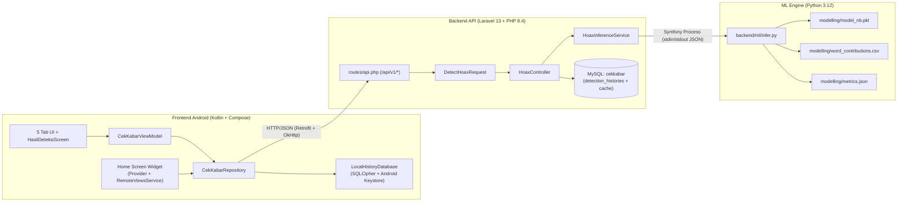

# Dokumen Rancangan Detail (Software Design Document) — CekKabar

**Versi:** 1.0  
**Tanggal:** 27 November 2026  
**Repositori:** `Blitzshooters/CekKabar`  
**Platform Target:** Android (Kotlin + Jetpack Compose, `minSdk = 33`, `compileSdk = 36`) & Backend Web API (Laravel 13 + MySQL + Python ML)

---

## 1. Ringkasan Eksekutif & Tujuan Sistem

**CekKabar** adalah aplikasi mobile pendeteksi berita hoaks berbahasa Indonesia berbasis **Multinomial Naive Bayes** dan **TF-IDF** dengan pendekatan **Explainable AI (XAI)**. Sistem ini tidak hanya memberikan klasifikasi biner (`HOAKS` atau `FAKTA`), tetapi juga menampilkan transparansi skor kontribusi (*log-odds*) per kata agar pengguna memahami alasan di balik keputusan model.

### 1.1 Tujuan Utama
- **Deteksi Cepat & Transparan:** Mengklasifikasikan teks klaim/berita beserta probabilitas dan kata-kata pemicu utama.
- **Eksplorasi Model (XAI):** Menyediakan tab Analisis Model, Word Cloud per korpus (Hoaks vs Fakta), serta Metrik Evaluasi model secara terbuka.
- **Privasi & Ketahanan Offline:** Menyimpan riwayat deteksi lokal pada perangkat Android menggunakan **SQLCipher** dengan kunci terenkripsi di **Android Keystore (AES-256-GCM)**.
- **Akses Cepat Home Screen:** Menyediakan widget Android interaktif dengan fitur *Tempel & Cek*, filter riwayat (*Semua / Hoaks / Fakta*), dan daftar 10 riwayat terbaru yang dapat di-scroll.

---

## 2. Arsitektur Sistem

Sistem dibangun dengan arsitektur **3-Tier** yang memisahkan *presentation layer* (Android), *application/persistence layer* (Laravel + MySQL), dan *inference engine* (Python scikit-learn).



### 2.1 Struktur Direktori Proyek

```text
CekKabar/
├── modelling/          # Training ML (train_model.py), metrik, dan generator simulasi Excel
├── backend/            # Laravel 13 REST API, MySQL migrations, dan bridge ML (ml/infer.py)
├── frontend/           # Aplikasi Android Kotlin + Jetpack Compose + SQLCipher + AppWidget
└── docs/               # Spesifikasi desain Stitch, ikon SVG, simulasi Excel, dan SDD ini
```

---

## 3. Desain Machine Learning & Pemodelan (`modelling/`)

### 3.1 Dataset & Pelatihan
- **Sumber Dataset:** Gabungan korpus berita seimbang dari **TurnBackHoax.id (Mafindo)**, **AntaraNews**, **Kompas**, dan **Detik** (`modelling/Dataset Deteksi Berita Hoaks Indo/Cleaned Dataset V3/`).
- **Pembagian Data:**
  - Data Latih (`n_train`): **18.905** dokumen
  - Data Uji (`n_test`): **4.727** dokumen
  - Ukuran Kosakata TF-IDF (`n_vocab`): **20.000** fitur
- **Algoritma:** Pipeline `TfidfVectorizer` + `MultinomialNB` (dengan *Laplace smoothing*).

### 3.2 Formulasi Explainable AI (XAI)
Setiap kata $w$ dievaluasi kontribusinya menggunakan selisih log-likelihood (*log-odds ratio*):

$$\text{Skor}(w) = \ln P(w \mid \text{Hoaks}) - \ln P(w \mid \text{Fakta})$$

- **$\text{Skor}(w) > 0$:** Kata cenderung mengindikasikan **HOAKS**.
- **$\text{Skor}(w) < 0$:** Kata cenderung mengindikasikan **FAKTA**.
- Hasil perhitungan global disimpan ke `modelling/word_contributions.csv` untuk dipakai ulang oleh tab *Analisis* dan *WordCloud*.

### 3.3 Performa Model Aktual (`modelling/metrics.json`)

| Metrik | Nilai |
|---|---|
| Akurasi | **96,49%** (`0.9649`) |
| Presisi | **98,50%** (`0.985`) |
| Recall | **94,41%** (`0.9441`) |
| F1-Score | **96,41%** (`0.9641`) |
| 5-Fold Cross-Validation F1 | **96,68% ± 0,21%** |

**Confusion Matrix (4.727 data uji):**

| Aktual \ Prediksi | Prediksi Fakta (0) | Prediksi Hoaks (1) |
|---|---|---|
| **Aktual Fakta (0)** | `2.330` (TN) | `34` (FP) |
| **Aktual Hoaks (1)** | `132` (FN) | `2.231` (TP) |

### 3.4 Simulasi Excel (`modelling/generate_excel.py`)
Menghasilkan workbook `docs/simulasi_naive_bayes_cekkabar.xlsx` (7 sheet) yang seluruh perhitungannya memakai formula Excel asli (`SUBSTITUTE` untuk stopword removal, `COUNTIF` untuk frekuensi, `LN()` dan `VLOOKUP` untuk log-posterior, serta `EXP()` untuk probabilitas softmax) agar dapat diaudit secara matematis.

---

## 4. Desain Backend REST API (`backend/`)

### 4.1 Kontrak Endpoint (`/api/v1`)
Didefinisikan di `backend/routes/api.php` dan ditangani oleh `App\Http\Controllers\Api\HoaxController`:

| Method | Endpoint | Controller Action | Fungsi |
|---|---|---|---|
| `GET` | `/api/v1/health` | `health` | Cek status kesehatan API |
| `POST` | `/api/v1/detect` | `detect` | Validasi input (`DetectHoaxRequest`: 10–5000 karakter), jalankan inferensi ML, simpan ke MySQL |
| `GET` | `/api/v1/examples` | `examples` | Mengembalikan daftar contoh klaim berita siap uji |
| `GET` | `/api/v1/analysis` | `analysis` | Statistik global korpus, prior, dan top kata hoaks/fakta (di-cache 1 jam) |
| `GET` | `/api/v1/wordcloud` | `wordcloud` | Daftar kata dominan per korpus (`hoaks` / `fakta`) dengan filter `?query=` (di-cache 30 menit) |
| `GET` | `/api/v1/evaluation` | `evaluation` | Metrik evaluasi, confusion matrix, dan performa per kelas (di-cache 1 jam) |
| `GET` | `/api/v1/histories` | `histories` | Daftar riwayat dari MySQL dengan filter `?filter=all / hoaks / fakta` dan `?query=` |
| `GET` | `/api/v1/histories/{id}` | `showHistory` | Detail lengkap hasil deteksi berdasarkan ID |
| `DELETE` | `/api/v1/histories/{id}` | `destroyHistory` | Menghapus satu item riwayat |
| `DELETE` | `/api/v1/histories` | `clearHistories` | Menghapus seluruh riwayat |

### 4.2 Bridge Inferensi Python (`HoaxInferenceService.php` & `ml/infer.py`)
- `HoaxInferenceService` memanggil `PYTHON_BIN` (dikonfigurasi di `backend/.env`) menggunakan `Symfony\Component\Process\Process` dengan meneruskan variabel environment Windows (`SystemRoot`, `PATH`, `APPDATA`, `LOCALAPPDATA`, dll.) agar modul `asyncio`/Winsock pada Python 3.12 berjalan stabil.
- `backend/ml/infer.py` membaca model dan artefak langsung dari `../../modelling/` secara relatif (`model_nb.pkl`, `word_contributions.csv`, `metrics.json`).
- Pada mode `wordcloud`, `infer.py` memfilter skor secara ketat berdasarkan tanda korpus (`kontribusi_hoaks > 0` untuk `hoaks` dan `kontribusi_hoaks < 0` untuk `fakta`) sebelum melakukan pengurutan dan normalisasi bobot.

### 4.3 Skema Basis Data MySQL (`detection_histories`)
Didefinisikan di `backend/database/migrations/2026_11_27_000001_create_detection_histories_table.php`:

| Kolom | Tipe | Keterangan |
|---|---|---|
| `id` | `BIGINT UNSIGNED` (PK) | Primary key auto-increment |
| `text` | `TEXT` | Teks berita / klaim yang diperiksa |
| `verdict` | `VARCHAR(16)` | `HOAKS` atau `FAKTA` |
| `hoax_probability` | `FLOAT` | Probabilitas hoaks (0–100) |
| `fakta_probability` | `FLOAT` | Probabilitas fakta (0–100) |
| `confidence_label` | `VARCHAR(64)` | Label tingkat keyakinan |
| `word_count` | `INTEGER` | Jumlah token kata |
| `top_keywords` | `JSON` (nullable) | Maksimal 3 kata kunci terkuat |
| `tokens` | `JSON` (nullable) | Tokenisasi lengkap + skor per kata |
| `top_influential_words` | `JSON` (nullable) | Daftar kata paling berpengaruh |
| `created_at`, `updated_at` | `TIMESTAMP` | Waktu pencatatan |

---

## 5. Desain Frontend Android (`frontend/`)

### 5.1 Arsitektur & Dependency Injection
- **Pola:** Single-Activity (`MainActivity`) + Jetpack Compose Navigation + **MVVM** (`CekKabarViewModel` dengan `StateFlow<CekKabarUiState>`) + Repository Pattern (`CekKabarRepository`).
- **Manual DI (`AppContainer`):** Diinisialisasi di `CekKabarApp` (`Application` subclass) untuk merangkai `OkHttpClient`, `Retrofit` (`BuildConfig.BASE_URL`), `KeystoreManager`, `LocalHistoryDatabase`, dan `CekKabarRepository`.
- **Ketahanan Offline:** Setiap deteksi berhasil disimpan ke SQLCipher lokal. Saat server offline, `getHistories()` dan `getHistoryDetail()` otomatis fallback ke database lokal.

### 5.2 Struktur Layar & Navigasi
Navigasi utama menggunakan `NavigationBar` 5 tab:
1. **Deteksi (`DeteksiScreen`):** Hero banner, input teks dengan tombol *Tempel* & *Hapus (`X`)* sejajar (`32.dp`), tombol *Periksa Sekarang*, dan daftar contoh berita.
2. **Analisis (`AnalisisScreen`):** Toggle *Global (Korpus)* vs *Teks Terakhir*, prior probabilitas, daftar indikator kata hoaks/fakta, dan ringkasan rumus Naive Bayes.
3. **WordCloud (`WordCloudScreen`):** Toggle *Korpus Hoaks* / *Korpus Fakta*, visualisasi awan kata tipografi organik (*interleaved*), tap kata untuk inspeksi skor log-odds, search bar, dan 5 kata dominan teratas.
4. **Evaluasi (`EvaluasiScreen`):** 4 *MetricRingCard* (Akurasi, Presisi, Recall, F1), heatmap Confusion Matrix 2×2, performa per kelas, dan spesifikasi korpus.
5. **Riwayat (`RiwayatScreen`):** Pencarian, filter chip (*Semua / Hoaks / Fakta*), daftar riwayat, hapus satuan/semua, serta indikator status enkripsi lokal.
- **Layar Detail (`HasilDeteksiScreen`):** Gauge semi-sirkular animasi, teks dengan highlight warna per token (dapat diketuk), detail log-likelihood token terpilih, grafik batang dua arah (*DualDirectionBarChart*), dan tombol bagikan.

### 5.3 Sistem Desain (*Editorial Intelligence*)
- **Palet Warna (`ui/theme/Color.kt`):** Indigo Primary (`#3F3DBF`), Fact Green (`#2E9E5B`), Hoax Red (`#E5484D`), Background Light (`#F8F9FC`).
- **Ikon Aplikasi & Top Bar:** Adaptive Icon Vector Drawable (`ic_launcher_background.xml` gradien `#5856E0` → `#2A2890` + `ic_launcher_foreground.xml` perisai & kaca pembesar) yang juga dirender konsisten pada `CekKabarTopBar`.

### 5.4 Desain Widget Home Screen (`widget/`)
- **Komponen:** `CekKabarWidgetProvider` (`AppWidgetProvider`) dan `CekKabarWidgetService` (`RemoteViewsService` + `RemoteViewsFactory`), terdaftar di `AndroidManifest.xml` dengan izin `BIND_REMOTEVIEWS`.
- **Fitur Utama:**
  - **Quick Chat Bar & "Tempel & Cek":** Mengatasi batasan keamanan Android `RemoteViews` (yang tidak mengizinkan `EditText` di Home Screen) dengan menyediakan tombol 1-tap *Tempel & Cek* yang membuka `MainActivity`, membaca clipboard secara otomatis, dan langsung menjalankan deteksi.
  - **Filter Langsung (`Semua` | `Hoaks` | `Fakta`):** Disimpan per `appWidgetId` di `SharedPreferences` dan memicu `notifyAppWidgetViewDataChanged`.
  - **Daftar Riwayat Scrollable:** `ListView` menampilkan maksimal **10 riwayat terbaru** dari `LocalHistoryDatabase`; mengetuk item langsung membuka detail hasil di `HasilDeteksiScreen`.
  - **Auto-Refresh:** `CekKabarRepository` memanggil `CekKabarWidgetProvider.refreshAllWidgets()` setiap kali ada deteksi baru atau penghapusan riwayat.

---

## 6. Keamanan & Perlindungan Data

| Aspek | Implementasi | Tujuan |
|---|---|---|
| **Enkripsi Database Lokal** | `net.zetetic:sqlcipher-android` (AES-256) | Melindungi isi riwayat berita di SQLite perangkat |
| **Manajemen Kunci** | `KeystoreManager` (Android Keystore AES-256-GCM) | Passphrase acak 32-byte dienkripsi hardware-backed Keystore |
| **Backup Protection** | `android:allowBackup="false"` di Manifest | Mencegah ekstraksi data lokal via ADB backup |
| **Kredensial Server** | `backend/.env` dikecualikan di `.gitignore` | Kredensial MySQL & `APP_KEY` tidak masuk repositori Git |

---

## 7. Konfigurasi Build, Pengujian & Deployment

### 7.1 Build Variants Android (`frontend/app/build.gradle.kts`)
- **`debug`:** `BuildConfig.BASE_URL` diarahkan ke IP WiFi lokal pengembangan (`http://192.168.1.7:8000/api/v1/`).
- **`release`:** `isMinifyEnabled = true` (ProGuard/R8 aktif) dengan `BuildConfig.BASE_URL` server produksi HTTPS.

### 7.2 Verifikasi & Pengujian
- **Backend Feature Tests:** `php artisan test` menggunakan SQLite `:memory:` (`phpunit.xml`) — 7 test case, 44 assertions lulus.
- **ML CLI Smoke Test:** `python backend/ml/infer.py predict|analysis|wordcloud|evaluation`.
- **Android Build:** `./gradlew.bat assembleDebug` terverifikasi `BUILD SUCCESSFUL`.

