# Flowchart Aplikasi CekKabar

> **Versi:** 1.0.0  
> **Tanggal:** 2026-11-27  
> **Stack:** Android (Kotlin + Jetpack Compose) · Laravel 13 (PHP 8.4) · Python 3.12 · MySQL

---

## Daftar Isi

1. [Arsitektur Sistem](#1-arsitektur-sistem)
2. [Alur Training Model ML](#2-alur-training-model-ml)
3. [Alur Utama: Deteksi Berita](#3-alur-utama-deteksi-berita)
4. [Alur Backend Inferensi](#4-alur-backend-inferensi)
5. [Alur Widget Home Screen](#5-alur-widget-home-screen)
6. [Alur Tab Riwayat](#6-alur-tab-riwayat)
7. [Alur Tab WordCloud](#7-alur-tab-wordcloud)
8. [Alur Tab Evaluasi](#8-alur-tab-evaluasi)
9. [Alur Data Repository (Offline-First)](#9-alur-data-repository-offline-first)

---

## 1. Arsitektur Sistem

Gambaran menyeluruh seluruh lapisan sistem CekKabar.

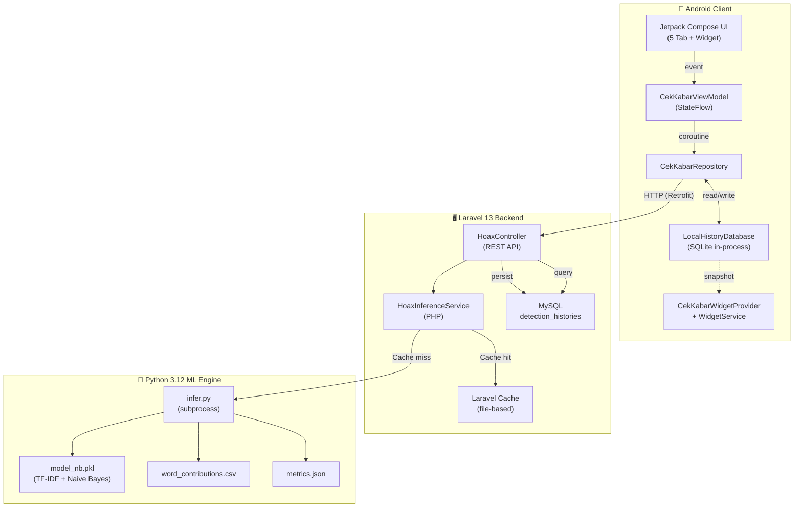

---

## 2. Alur Training Model ML

Dijalankan sekali offline sebelum deploy. Menghasilkan artefak yang dipakai `infer.py`.

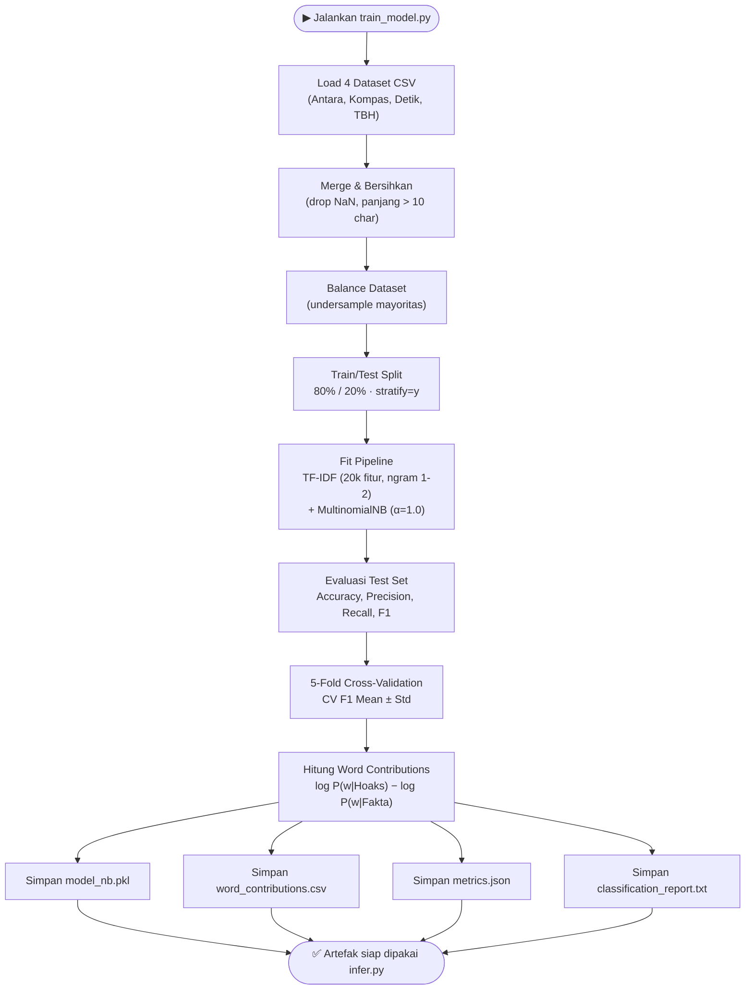

---

## 3. Alur Utama: Deteksi Berita

Alur lengkap dari input pengguna di Android hingga hasil ditampilkan.

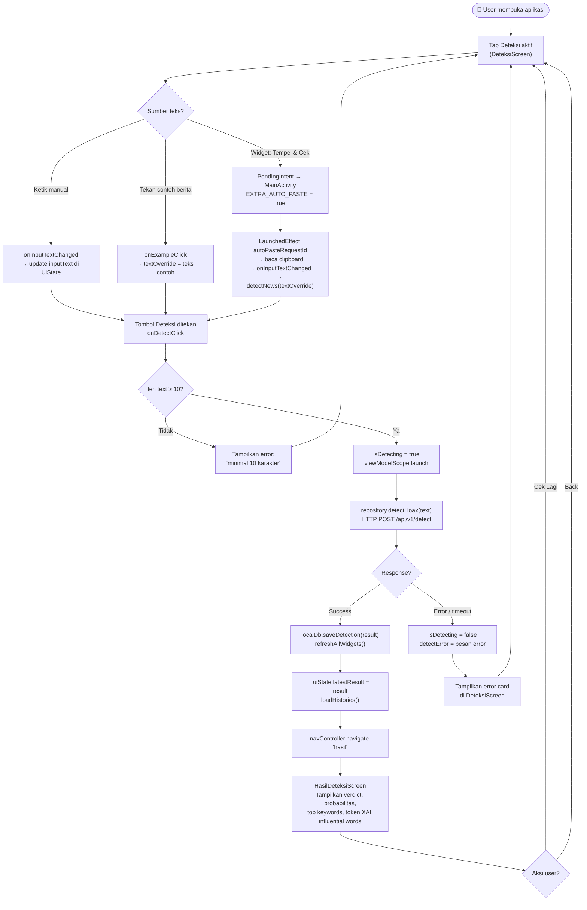

---

## 4. Alur Backend Inferensi

Detail proses di sisi server saat menerima request `POST /api/v1/detect`.

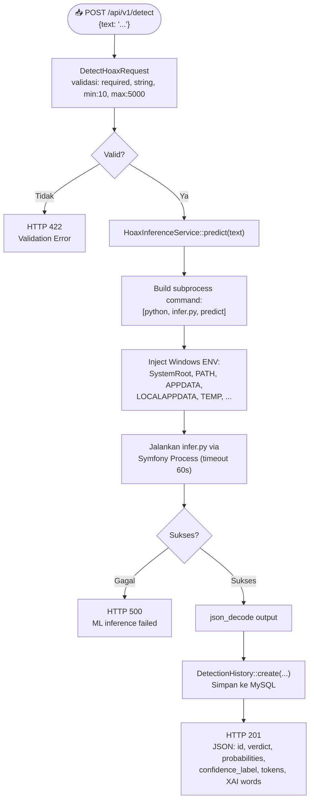

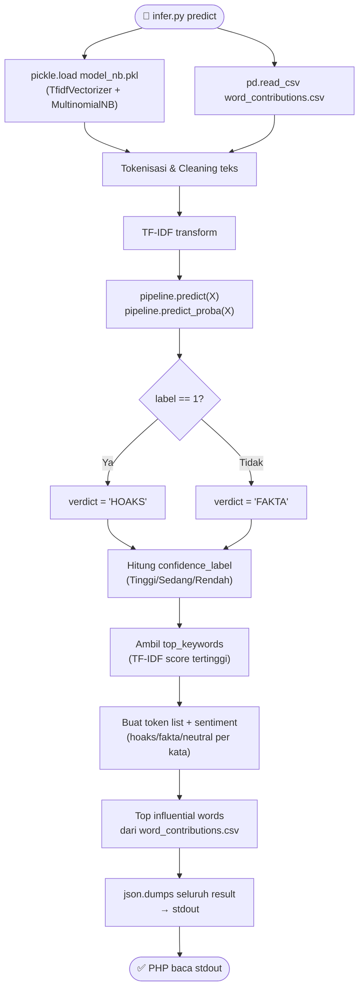

---

## 5. Alur Widget Home Screen

Interaksi antara Home Screen Widget dan aplikasi utama.

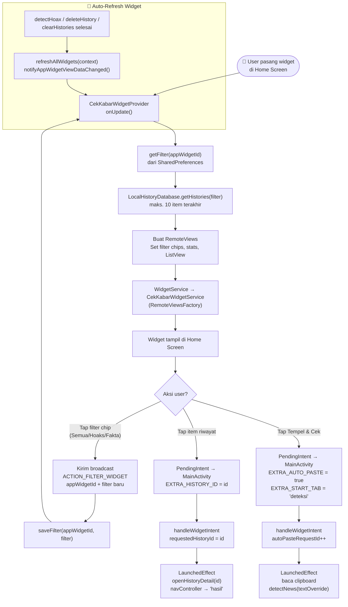

---

## 6. Alur Tab Riwayat

Manajemen riwayat deteksi dengan filter dan pencarian.

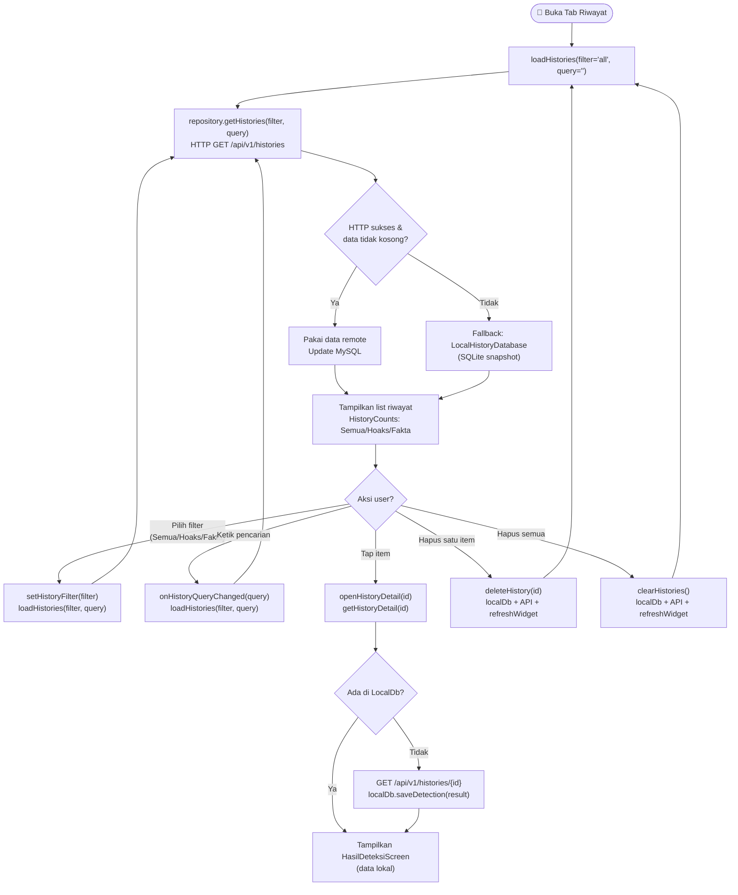

---

## 7. Alur Tab WordCloud

Eksplorasi distribusi kata penting per korpus dengan cache backend.

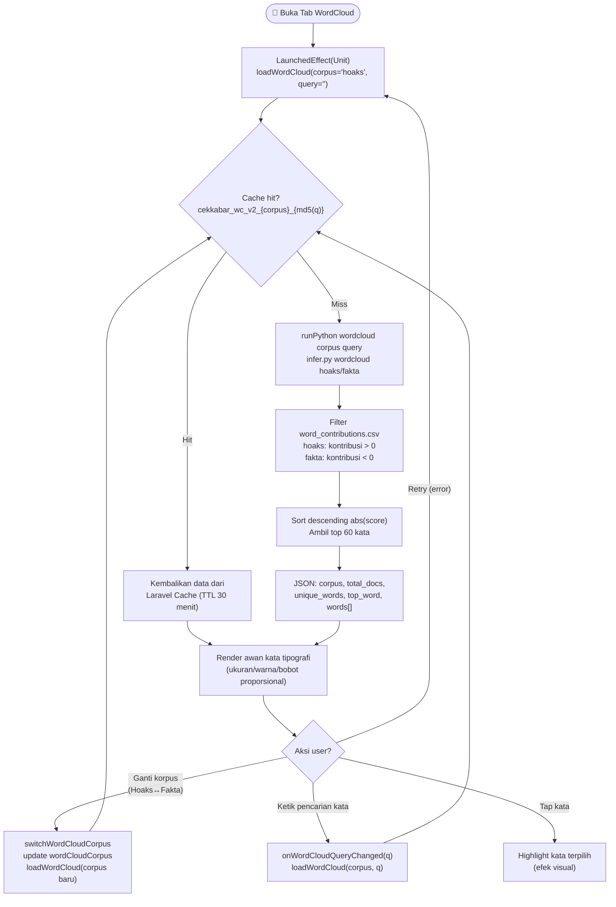

---

## 8. Alur Tab Evaluasi

Memuat dan menampilkan metrik performa model.

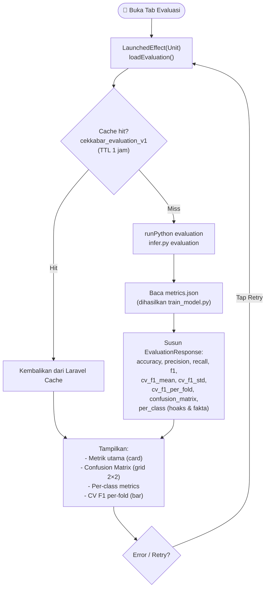

---

## 9. Alur Data Repository (Offline-First)

Strategi sinkronisasi antara remote API dan local database.

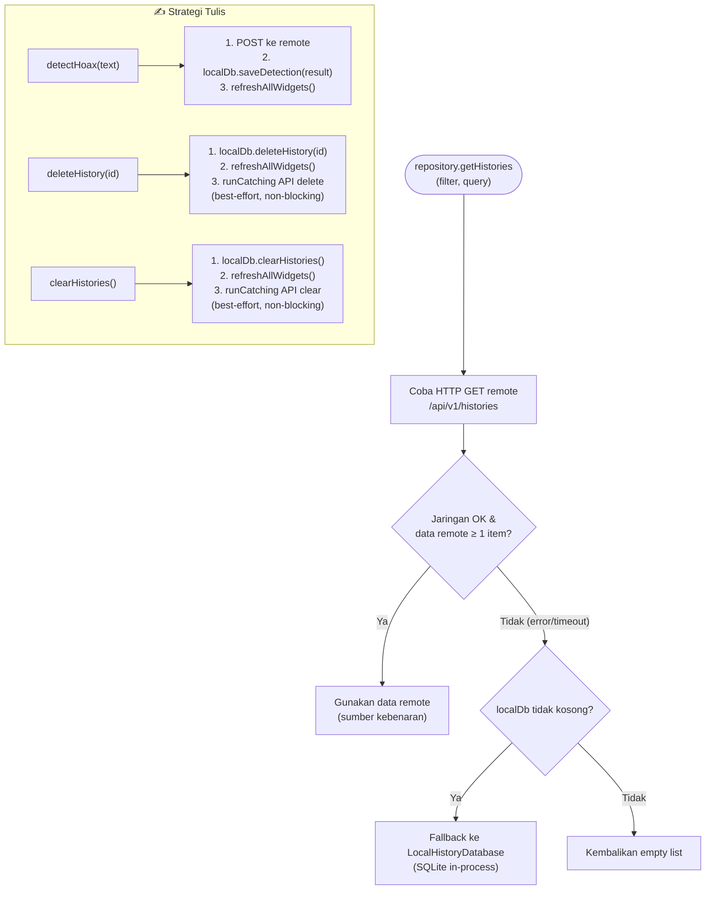

---

## Ringkasan Alur Navigasi Android

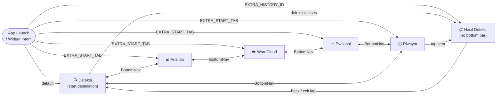

---

> [!NOTE]
> Semua flowchart menggunakan data nyata dari kode sumber aplikasi. Lihat file implementasi:
> - `frontend/.../MainActivity.kt` — navigasi & widget intent
> - `frontend/.../CekKabarViewModel.kt` — state management
> - `frontend/.../CekKabarRepository.kt` — offline-first strategy
> - `backend/app/Services/HoaxInferenceService.php` — Python subprocess
> - `backend/app/Http/Controllers/Api/HoaxController.php` — REST endpoints
> - `modelling/train_model.py` — pipeline ML training
> - `backend/ml/infer.py` — runtime inference
